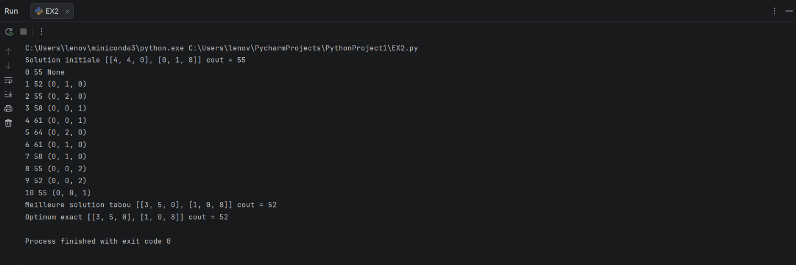
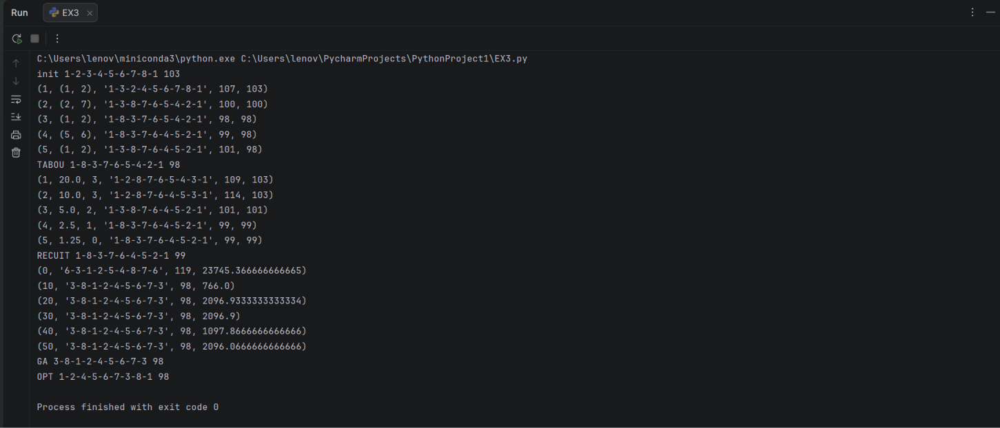

# TD Heuristiques & Méta-heuristiques – LSI3


Réalisé par : **Ghlissi Samar** – Groupe : **LSI3 3TP2**


| Exercice | Problème | Méthodes | Fichier |
|---|---|---|---|
| 2 | Transport de containers (dépôts → magasins) | Recherche tabou | `ex2.py` |
| 3 | Voyageur de commerce (8 villes) | Tabou, recuit simulé, algorithme génétique | `ex3.py` |


```bash
python EX2.py
python EX3.py
```

Dans PyCharm : clic droit sur le fichier, puis *Run*.

---

## Exercice 2 : Recherche Taboue (Transport)

**Problème.** Deux dépôts D1 et D2 (stocks 8 et 9 containers) livrent trois magasins M1, M2, M3 (demandes 4, 5 et 8). On cherche la répartition des livraisons qui minimise le coût total de transport.

| Coût unitaire | M1 | M2 | M3 | Stock |
|---|---|---|---|---|
| D1 | 5 | 3 | 4 | 8 |
| D2 | 6 | 7 | 2 | 9 |
| Demande | 4 | 5 | 8 | |

**Méthode.**
- Solution : matrice 2×3 des quantités transportées
- Solution initiale : coin nord-ouest (coût 55)
- Voisinage : transfert d'un container le long d'un cycle 2×2 (offres et demandes toujours respectées)
- Liste tabou : 5 dernières solutions, arrêt après 10 itérations

**Résultat attendu :** coût minimal **52**, avec D1→M1 : 3, D1→M2 : 5, D2→M1 : 1, D2→M3 : 8 (optimum confirmé par énumération des 29 solutions réalisables).

### Capture d'exécution



---

## Exercice 3 : Voyageur de commerce (8 villes)

**Problème.** Circuit le plus court passant une fois par chacune des 8 villes et revenant à la ville 1 (un « – » dans le tableau = pas de route). Solution initiale imposée : 1-2-3-4-5-6-7-8-1, de coût 103. Voisinage commun : 2-opt (inversion d'un segment).

| Méthode | Paramètres | Meilleur coût |
|---|---|---|
| Recherche tabou | liste de 3 solutions, 5 itérations | **98** |
| Recuit simulé | T0 = 20, α = 0,5, 5 paliers de 10 voisins, p = exp(−Δ/T) | 99 |
| Algorithme génétique | population 30, tournoi 3, croisement OX, mutation 0,2, élitisme 2, 50 générations | **98** |
| Optimum (5 040 circuits) | – | **98** |

Circuit optimal : `1-2-4-5-6-7-3-8-1` (14 + 14 + 11 + 15 + 9 + 9 + 9 + 17 = 98).

Le recuit simulé et l'algorithme génétique utilisent le hasard : les résultats varient d'une exécution à l'autre (ajouter `random.seed(1)` pour les reproduire).

### Capture d'exécution



---

## Références

- Cours *Heuristiques & Méta-heuristiques*, Hala Bezine, Faculté des Sciences de Sfax
- Énoncé du TD & Rendu (exercices 2 et 3)
