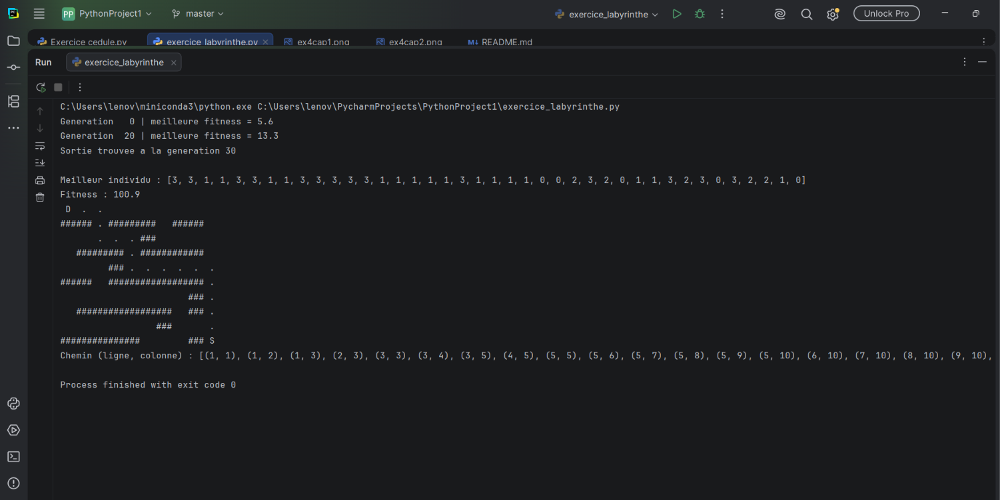

# Exercice 1 : robot dans un labyrinthe (algorithme génétique)

Heuristiques & Méta-heuristiques – LSI3 – Faculté des Sciences de Sfax
Réalisé par : **Nom Prénom** – Groupe : **…**

## Problème

Un robot se déplace dans un labyrinthe de 10 × 10 cases. Les cases tramées sont des murs, les cases blanches sont libres. Il part de l'**entrée (1,1)** (en haut à gauche) et doit atteindre la **sortie (10,10)** (en bas à droite). Il s'arrête dès qu'il :

- se cogne contre un mur (ou sort de la grille) ;
- revient sur une case déjà visitée ;
- ou atteint la sortie.

Le but est de trouver un parcours menant à la sortie avec un algorithme génétique.

## Le labyrinthe utilisé

La grille est le tableau `LABY` du programme (`1` = mur, `0` = case libre). Entrée : `LABY[0][0]`, sortie : `LABY[9][9]`. Pour changer de labyrinthe, il suffit de modifier ce tableau.

```
      1  2  3  4  5  6  7  8  9 10
  1   D  .  .  .  .  .  .  .  .  .
  2   #  #  .  #  #  #  .  #  #  .
  3   .  .  .  .  .  #  .  .  .  .
  4   .  #  #  #  .  #  #  #  #  .
  5   .  .  .  #  .  .  .  .  .  .
  6   #  #  .  #  #  #  #  #  #  .
  7   .  .  .  .  .  .  .  .  #  .
  8   .  #  #  #  #  #  #  .  #  .
  9   .  .  .  .  .  .  #  .  .  .
 10   #  #  #  #  #  .  .  .  #  S
```

`D` = départ, `S` = sortie, `#` = mur. Le plus court chemin de ce labyrinthe fait 18 pas (vérifié par un parcours en largeur).

## Question 1 : codage des individus

Un individu (chromosome) est une **liste de L = 40 déplacements**. Chaque gène est un entier qui code une direction :

| Gène | 0 | 1 | 2 | 3 |
|---|---|---|---|---|
| Direction | Haut | Bas | Gauche | Droite |

La fonction `creer_individu()` tire 40 gènes au hasard ; `creer_population()` en crée 100.

**Décodage** (fonction `parcours`) : on déroule les gènes un par un à partir de l'entrée. Le robot s'arrête s'il sort de la grille, touche un mur, revient sur une case déjà visitée ou atteint la sortie. Les gènes restants sont alors ignorés. La longueur 40 laisse une marge, puisque le plus court chemin fait 18 pas. L'espace de recherche compte 4⁴⁰ ≈ 1,2 × 10²⁴ individus : on ne peut pas tout énumérer.

## Question 2 : fonction fitness (à maximiser)

On simule le robot, puis on note l'endroit où il s'arrête (`fin`) :

| Terme | Valeur |
|---|---|
| Proximité de la sortie | `18 − d`, où `d` est la distance de Manhattan entre `fin` et la sortie (de 0 à 18) |
| Bonus de progression | `+ 0,1 × nombre de cases visitées` (petit bonus pour les chemins longs sans erreur) |
| Bonus de succès | si `fin` = sortie : `+ 100 − nombre de cases visitées` |

Le gros bonus de succès fait passer tout individu qui atteint la sortie bien devant les autres, et le terme `100 − nombre de cases` préfère les chemins courts. Un robot qui se cogne dès le premier pas obtient une fitness très faible.

## Question 3 : opérateur de mutation

**Mutation ponctuelle** (fonction `mutation`) : chaque gène est remplacé par une direction tirée au hasard avec la probabilité **P_MUTATION = 0,05**. Avec 40 gènes, un individu subit en moyenne 2 changements. La mutation introduit de nouvelles directions et permet de sortir des impasses.

## Question 4 : code complet et opérateurs génétiques

Fichier `exercice_labyrinthe.py`.

| Élément | Choix |
|---|---|
| Population initiale | 100 individus aléatoires |
| Sélection | tournoi de taille 3 (`selection_tournoi`) |
| Croisement | à un point, probabilité 0,9 (`croisement`) |
| Mutation | ponctuelle, probabilité 0,05 par gène (`mutation`) |
| Élitisme | les 2 meilleurs individus passent à la génération suivante |
| Arrêt | sortie trouvée, ou 300 générations |

Déroulement de `algorithme_genetique()` :

1. Créer la population initiale.
2. Calculer la fitness de chaque individu et mémoriser le meilleur trouvé.
3. Si le meilleur atteint la sortie, arrêter.
4. Sinon, copier les 2 élites, puis former des enfants (deux parents par tournoi, croisement, mutation) jusqu'à remplir la population.
5. Recommencer à l'étape 2.

## Exécution

```bash
python exercice_labyrinthe.py
```

Aucune bibliothèque externe n'est nécessaire. Le programme n'utilise pas de graine : les résultats varient d'une exécution à l'autre.

## Résultats

Exemple d'exécution : la fitness du meilleur passe de 3,4 (génération 0) à 12,2 (génération 20) puis à 17,9 (génération 40), et la **sortie est trouvée à la génération 45**. Le parcours trouvé fait 18 pas, c'est-à-dire le plus court chemin :

```
déplacements : DDDDDDBBDDDBBBBBBB
```

```
      1  2  3  4  5  6  7  8  9 10
  1   D  *  *  *  *  *  *  .  .  .
  2   #  #  .  #  #  #  *  #  #  .
  3   .  .  .  .  .  #  *  *  *  *
  4   .  #  #  #  .  #  #  #  #  *
  5   .  .  .  #  .  .  .  .  .  *
  6   #  #  .  #  #  #  #  #  #  *
  7   .  .  .  .  .  .  .  .  #  *
  8   .  #  #  #  #  #  #  .  #  *
  9   .  .  .  .  .  .  #  .  .  *
 10   #  #  #  #  #  .  .  .  #  S
```

Sur 30 exécutions indépendantes, l'algorithme trouve la sortie **30 fois sur 30**, en moyenne à la génération 40 (au plus à la génération 55). Tous les parcours trouvés font 18 pas, soit la longueur optimale. La fitness progresse régulièrement, car la distance à la sortie diminue le long du chemin ; le bonus `100 − nombre de cases` pousse ensuite vers le chemin le plus court.

### Capture d'exécution


